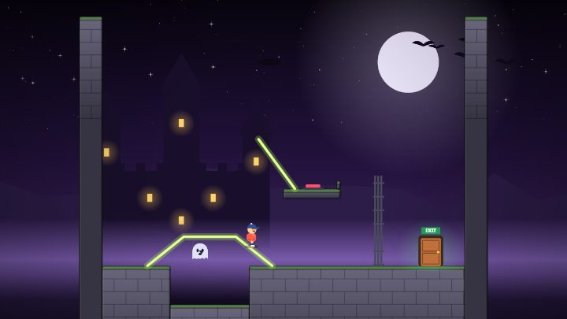

# Trap Walker

**He walks. You draw. Don't let him die.**

### [Play it now in your browser](https://r4ij3n-droid.github.io/trap-walker/)

A little guy in a red hoodie is about to walk straight into a pit of spikes, and he is not going to stop. All you've got is your finger.

Draw a line and he walks on it. Make it a bridge over the pit, a hump over the spikes, a ramp up to the ledge or a wall that turns him around. The second you lift your finger, he starts walking, so every line after the first one, you're drawing while he's on the move.

Use less ink and you earn more stars. Use too little and, well, he falls.

**What's in it**

- 90 handmade levels across 9 worlds: Trap Factory, Rooftops, The Moon, Candy Land, Haunted Castle, Clockwork Tower, Deep Sea, Volcano and Sky Temple.
- Every world brings a new trick: crumbling tiles, springs, low gravity, ghosts you trap under a dome, levers, lasers, ocean currents, lava heat that melts your lines and rainbow rings that teleport him.
- Your lines don't have to be perfect. Wobbly is fine.
- Three stars per level and outfits to unlock.
- Plays in portrait or landscape, in English or Arabic.

Made for YouTube Playables.
